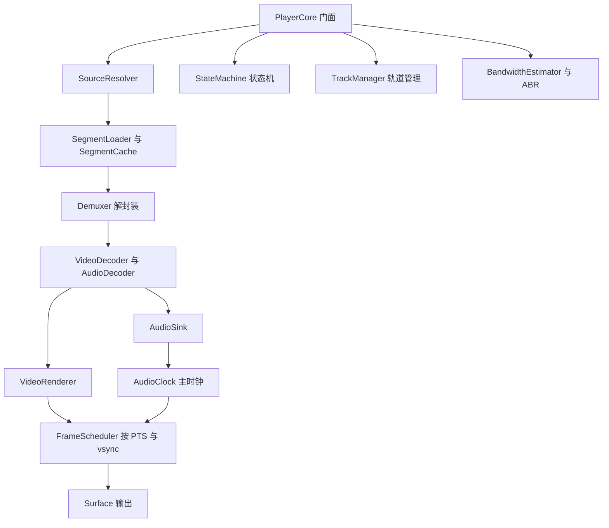

# 自研播放核心设计

## 1. 目标与边界

目标：为影視TV 手机端提供一套不依赖 media3 与 mpv 的播放核心，优先使用 Android 平台能力，做到低内存、低 CPU、稳定帧调度，覆盖渐进式文件、DASH/MPD、HLS 与常见容器格式。

硬性目标：

- 默认路径零 FFmpeg，使用 `MediaExtractor + MediaCodec + AudioTrack + Surface + Choreographer`。
- 支持 24/25/30/50/60/90/120fps 与可变帧率，按 PTS 调度，不按固定帧率猜。
- 支持 4K/8K，实际分辨率上限由设备硬解能力决定。
- 支持 MPD、M3U8、MP4、MKV、TS、FLV、WebM 等常见来源。
- 播放、暂停、拖动、切轨、倍速、后台音频、画中画、投屏接口完整。
- 单实例内存目标：1080p 硬解 < 120MB，4K 硬解 < 300MB，缓冲时长 2-10 秒自适应。

非目标（第一版不做）：

- 8K 软件解码。
- DRM（Widevine/PlayReady）在 P2 接入。
- 蓝光原盘菜单。
- 桌面级滤镜链与专业调色。

## 2. 总体架构



数据流：Source 产生媒体段，Demuxer 输出压缩样本，Decoder 输出纹理或 PCM，Renderer 按主时钟与 vsync 呈现，AudioSink 驱动音频时钟。

## 3. 模块划分

```text
playback-core/
├─ api/        PlayerCore、MediaSource、TrackInfo、Listener、State
├─ source/     ProgressiveSource、DashSource、HlsSource、SegmentLoader、Cache
├─ demux/      ExtractorDemuxer、FfmpegDemuxer（可选）
├─ decode/     VideoDecoder、AudioDecoder、CodecSelector、SurfacePool
├─ render/     VideoRenderer、GlScaleRenderer、FrameScheduler
├─ audio/      AudioTrackSink、AudioResampler、AudioClock
├─ clock/      MasterClock、StandaloneClock、RenderClock
├─ util/       BufferPool、RateLimiter、Ewma、MimeTypes
└─ view/       SurfacePlayerView、AspectRatioLayout
```

模块之间只通过接口通信，默认实现全部在 `core` 包内，方便后续替换 FFmpeg 解封装或渲染器。

## 4. 播放管线

### 4.1 解封装

默认使用 `MediaExtractor`：

- 支持 MP4/M4V、MKV/WebM、TS、FLV、MP3、AAC、FLAC、OGG、WAV 等。
- 通过 `setDataSource(MediaDataSource)` 接入自定义数据源，DASH/HLS 的段数据可以走内存或本地缓存文件。
- 输出 `MediaFormat` 与压缩样本，直接送入 `MediaCodec`。

FFmpeg 兜底（可选模块）：

- 覆盖 RMVB、AVI、WMV、MPEG-2、DTS 等平台不支持的容器与编码。
- 只做软件解码，按需开启，默认不打包进 APK。

### 4.2 解码

视频：

- 优先 `MediaCodec` 异步模式，输出到 `Surface`，零拷贝。
- 通过 `MediaCodecList` 与 `VideoCapabilities` 选择硬解，检查分辨率、帧率、码率、HDR、色彩空间。
- 设备不支持时回退软件解码（FFmpeg 或平台软件解码器）。
- 队列上限：压缩包 64，输出帧 8，超过即暂停解封装，避免内存膨胀。

音频：

- `MediaCodec` 解码为 PCM，`AudioTrack` 输出。
- 低延迟模式使用 `PERFORMANCE_MODE_LOW_LATENCY`（API 26+）。
- 支持 16bit/float、单/双声道、5.1 下混、采样率转换。

### 4.3 渲染与帧调度

- `SurfaceView` 作为默认输出，零拷贝，功耗低。
- OpenGL ES 管线负责比例、旋转、裁剪、HDR 到 SDR 的色调映射。
- `Choreographer` 按 vsync 调度：
  - 计算 `renderTime = ptsUs - masterClockUs`。
  - `renderTime <= 0` 且落后超过 `dropThreshold` 时丢帧。
  - 未到呈现时间时保留当前帧，等待下一个 vsync。
  - 支持可变帧率，不假设固定 fps。
- API 30+ 使用 `Surface.setFrameRate` 与 `MediaFormat.KEY_FRAME_RATE` 给系统提示。
- HDR：读取 `KEY_COLOR_TRANSFER`/`KEY_COLOR_STANDARD`，HDR 屏幕直通，SDR 屏幕走 GL 色调映射。

### 4.4 音视频同步

- 有音频时，`AudioClock` 为主时钟：`position = 已写入PCM对应的PTS - AudioTrack缓冲延迟`。
- 无音频时，`SystemClock` 或视频时钟为主时钟。
- 视频按主时钟调度，音频按 `AudioTrack` 播放头校正。
- 拖动时：暂停解封装，flush 解码器，清空队列，重置时钟，从最近关键帧重新预缓冲。
- 倍速：音频使用 `PlaybackParams`，视频按倍速缩放 PTS 调度。

## 5. DASH 与 HLS

### 5.1 DASH/MPD

解析内容：

- `MPD`：`mediaPresentationDuration`、`minBufferTime`、`type`（static/dynamic）。
- `Period`：多周期拼接。
- `AdaptationSet`：视频、音频、字幕。
- `Representation`：`id`、`bandwidth`、`codecs`、`width`、`height`、`frameRate`、`audioSamplingRate`。
- 分段方式：`SegmentTemplate`（`$Number$`、`$Time$`、`$RepresentationID$`）、`SegmentList`、`SegmentBase`、`SegmentTimeline`。
- `BaseURL` 继承与相对路径解析。

播放策略：

- 首段选择：优先设备硬解能力内的最高分辨率，再用带宽估计降级。
- ABR：EWMA 吞吐 + 缓冲水位，段边界切换，切换后重初始化解码器。
- 直播：`dynamic` MPD 定时刷新，按 `availabilityStartTime` 与 `timeShiftBufferDepth` 计算可用窗口。
- 缓存：段级 LRU，内存 + 磁盘两级；预取 1-2 个段。

### 5.2 HLS

- 解析 master playlist、media playlist、`EXT-X-STREAM-INF`、`EXT-X-MEDIA`、`EXT-X-MAP`、`EXT-X-BYTERANGE`、`EXT-X-DISCONTINUITY`。
- TS 与 fMP4 两种分片；直播按 `EXT-X-MEDIA-SEQUENCE` 滚动。
- ABR 与 DASH 共用带宽估计器。

## 6. 低占用策略

- 硬解优先，零拷贝 Surface，避免 CPU 色彩转换。
- 每类轨道只保留一个解码器实例，切轨时复用或快速重建。
- 有界队列 + 背压：解码器输出满时停止喂包，播放器暂停时停止下载。
- 直接缓冲区与对象池，渲染循环零分配。
- 缓冲自适应：Wi-Fi 2-6 秒，移动网络 4-10 秒，低内存时收紧。
- 后台/画中画切换时释放视频解码器，保留音频。
- 统计面板：码率、丢帧、解码耗时、缓冲水位、ABR 决策。

## 7. 格式支持矩阵

| 来源/格式 | 默认路径 | 兜底路径 |
| --- | --- | --- |
| MP4/M4V | MediaExtractor + 硬解 | FFmpeg |
| MKV/WebM | MediaExtractor + 硬解 | FFmpeg |
| TS/M2TS | MediaExtractor + 硬解 | FFmpeg |
| FLV | MediaExtractor | FFmpeg |
| HLS (TS/fMP4) | 自研解析 + 平台解码 | FFmpeg |
| DASH/MPD (fMP4/TS) | 自研解析 + 平台解码 | FFmpeg |
| RMVB/AVI/WMV | 可选 FFmpeg | FFmpeg |
| H.264/HEVC/VP9/AV1 | MediaCodec | FFmpeg 软件解码 |
| AAC/MP3/Opus/FLAC | MediaCodec | FFmpeg |

## 8. API 草案

```java
public interface PlayerCore {
    void setSource(MediaSource source);
    void prepare();
    void play();
    void pause();
    void stop();
    void seekTo(long positionMs);
    void setSurface(Surface surface);
    void setVolume(float volume);
    void setSpeed(float speed);
    void selectTrack(TrackType type, int index);
    void release();

    PlayerState getState();
    long getPosition();
    long getDuration();
    boolean isPlaying();
    TrackInfo[] getTracks();

    void addListener(PlayerListener listener);
    void removeListener(PlayerListener listener);
}
```

```java
public abstract class MediaSource {
    public abstract String uri();
    public abstract SourceType type();
}

public final class ProgressiveSource extends MediaSource { }
public final class DashSource extends MediaSource { }
public final class HlsSource extends MediaSource { }
```

```java
public interface PlayerListener {
    void onPrepared(TrackInfo[] tracks, long durationMs);
    void onBufferingChanged(boolean buffering, int percent);
    void onFirstFrameRendered();
    void onVideoSizeChanged(int width, int height, float fps);
    void onEnded();
    void onError(PlaybackException error);
}
```

## 9. 里程碑

| 阶段 | 内容 | 验收 |
| --- | --- | --- |
| P0 | 渐进式 MP4/MKV/TS + 硬解 + 音视频同步 + 播放/暂停/拖动 | 本地文件与直链稳定播放，1080p 60fps 无持续丢帧 |
| P1 | MPD/HLS 解析、段下载、缓存、ABR | DASH VOD 与 HLS VOD 可播放，码率可切换 |
| P2 | 直播 DASH/HLS、低延迟、DRM、HDR 色调映射 | 直播 5-15 秒延迟，Widevine 可播 |
| P3 | FFmpeg 兜底、RTSP/RTMP、8K、统计面板 | 平台不支持的格式可软解播放 |

## 10. 与现有 App 的迁移

1. 新增 `playback-core` 模块，先独立编译与测试。
2. 在 App 中引入 `PlaybackEngine` 抽象，保留旧引擎作为 A/B 对照。
3. 用 `SurfacePlayerView` 替换 `PlayerView`，用 `PlayerCore` 替换 `PlayerManager` 的 media3 依赖。
4. 重写 `VideoActivity`、`LiveActivity`、`PlaybackService` 的播放器绑定，保留现有控制层与 UI。
5. 移除 media3/mpv 依赖，保留字幕、弹幕、投屏等上层协议。
